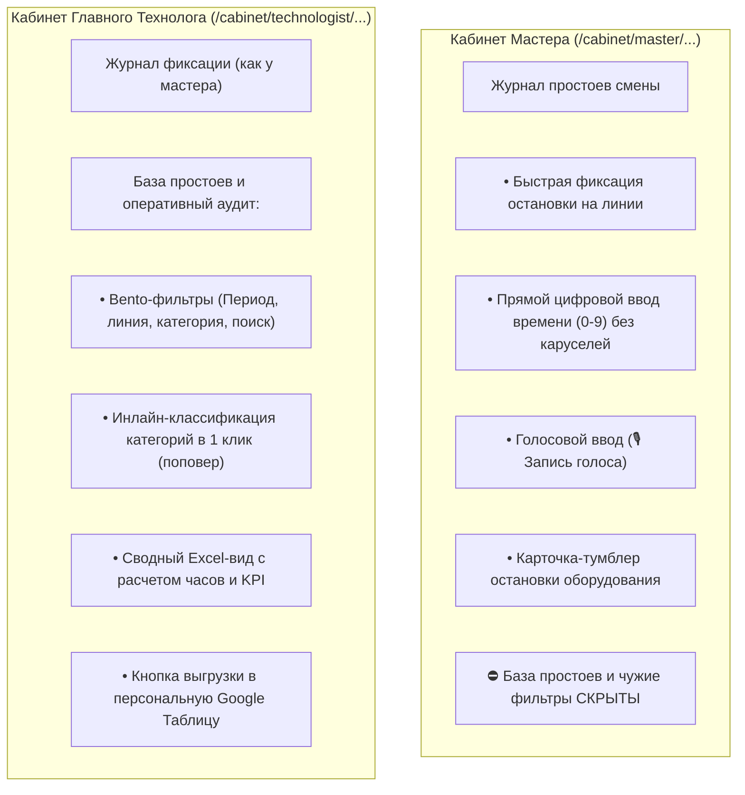

# Спецификация и архив: База простоев и интеграция с Google Таблицами (Tectum Downtimes Workspace)

> 📌 **Статус документа:** Зафиксирован и сохранен в резервной ветке `backup/downtimes-workspace-v1` на GitHub.  
> 🎯 **Очередность выполнения:** Внедряется **строго после** завершения архитектурных правок по авторизации и разделению кабинетов.

---

## 1. Концепция ролевого разделения простоев

Когда мы вернемся к реализации Базы простоев после настройки авторизации, структура будет разделена:

---

## 2. Подготовленные и сохраненные модули

Все разработанные компоненты сохранены в ветке Git: `backup/downtimes-workspace-v1`:

1. **Экспорт в Google Таблицу предприятия:**
   * Таблица: **«Сводная таблица простоев TECTUM»**
   * URL: `https://docs.google.com/spreadsheets/d/1Til9axXv7_U6TLsfYr3Cd4pKufuxnV8FY4F5QKfG5Qk/edit`
   * Идентификатор: `DOWNTIMES_SPREADSHEET_ID = "1Til9axXv7_U6TLsfYr3Cd4pKufuxnV8FY4F5QKfG5Qk"`
   * Модуль экспорта: `google_sheets_integration.py` ➔ функция `export_downtime_report_to_google_sheets(db, start_date, end_date)`.
   * Формирует фирменные цветные листы: *Простои ЛФМ 1*, *Простои ЛФМ 2*, *Простои СВОД* с формулами суммирования и KPI.

2. **Бэкенд API (`routers/downtimes.py`):**
   * `GET /api/downtimes/feed` — оперативная лента остановок с фильтрами по датам и линиям.
   * `PATCH /api/downtimes/{id}/category` — мгновенная классификация категории технологом в 1 клик.
   * `GET /api/downtimes/report-summary` — сводный расчет часов по 5 категориям.
   * `POST /api/downtimes/export/google-sheets` — фоновая синхронизация с Google Таблицей.

3. **Интерфейс Базы технолога (`static/js/downtimes_tab.js` и стили в `static/css/style.css`):**
   * Быстрый выбор категории через выпадающий поповер.
   * Bento-чипы быстрого выбора периода (Сегодня, Вчера, Эта неделя, Этот месяц).
   * Автоматический расчет продолжительности в минутах и часах.

4. **Прямой ввод времени (`bindNumericTimeInput`):**
   * Полное отсутствие тормозящих выпадающих барабанов времени на смартфонах и ПК.
   * Режим клавиатуры `inputmode="numeric"` (открывает крупные цифры 0-9 на телефоне).
   * Авто-подстановка двоеточия при наборе двух цифр (`14` ➔ `14:`).
   * Кнопки быстрого заполнения текущего времени `[Сейчас]`.

---

## 3. План подключения после реализации авторизации

1. **Сначала (Текущий приоритет):**
   * Реализация схемы пользователя: `Единый вход (/) ➔ Авторизация (Кто ты?) ➔ Направление в изолированный Кабинет с четким адресом (Куда тебе можно?)`.
   * Создание отдельных рабочих зон для Мастера, Технолога, Механика и Гостя (режим просмотра).
2. **Затем (Подключение базы):**
   * Встроить модуль `downtimes_tab.js` строго в контейнер Кабинета технолога.
   * В кабинете мастера оставить только компактную карточку ввода с цифровым временем без доступа к базе аудита.
